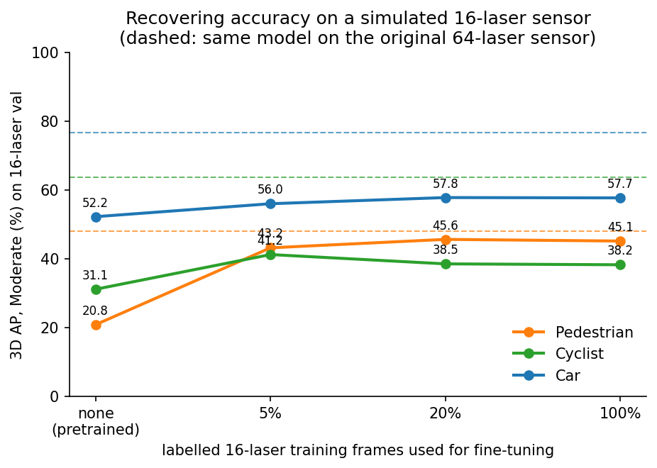
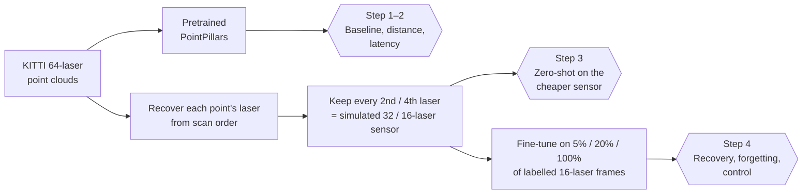
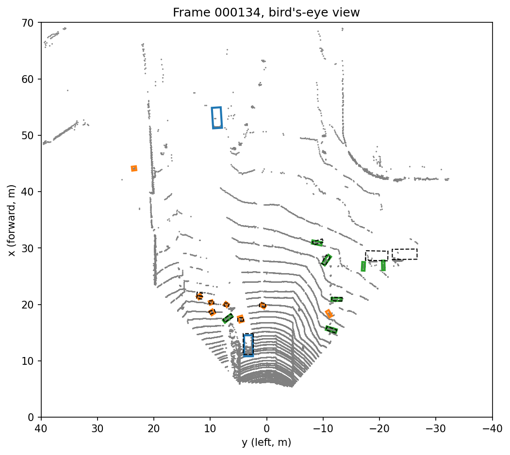
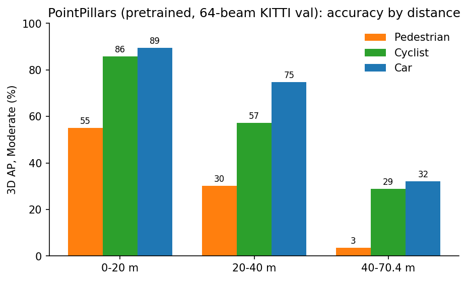
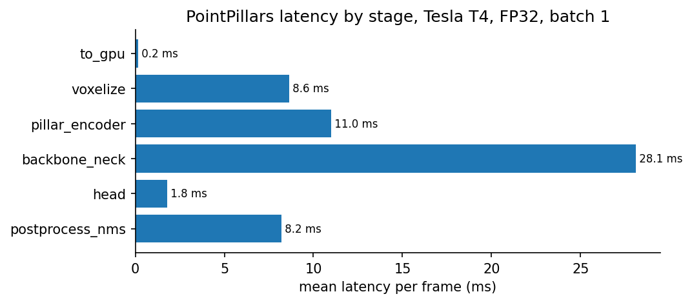
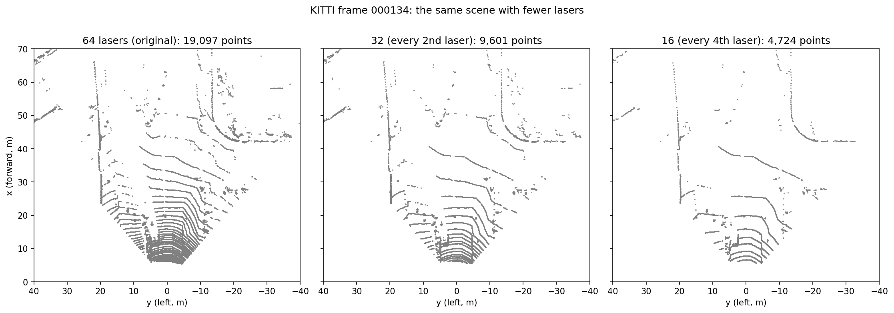
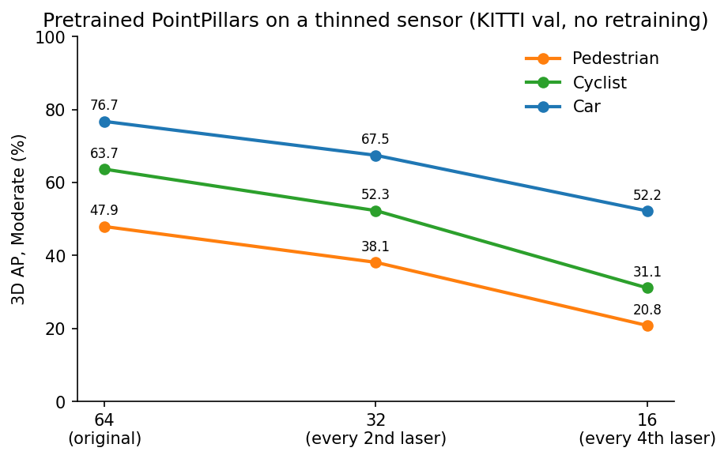
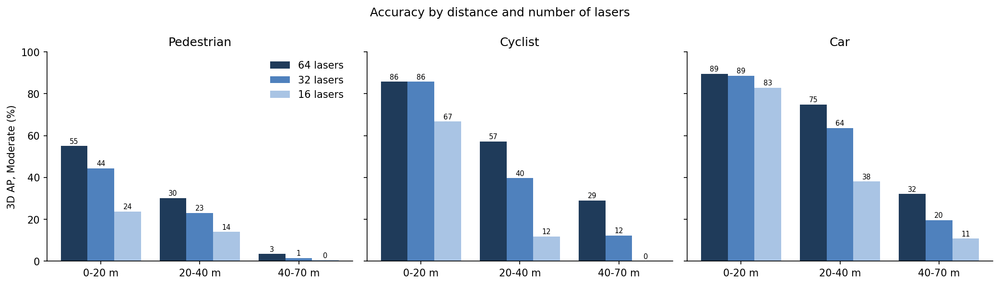
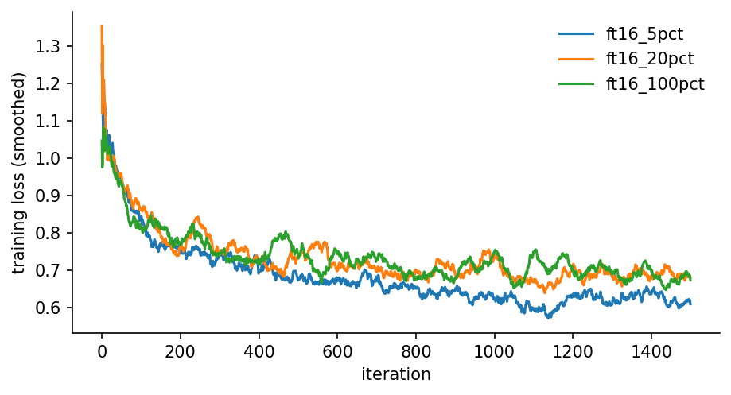

<div align="center">

# When the Sensor Changes

### How a LiDAR 3D detector breaks on a cheaper sensor, and how few labels it takes to fix it

<p>


</p>



<sub><b>186 labelled frames from the new sensor recover 82% of the pedestrian accuracy lost to the sensor change.</b><br>Dashed lines: the same detector on the original 64-laser sensor.</sub>

</div>

---

## TL;DR

Perception models are trained on expensive, roof-mounted LiDAR. Small delivery robots and field vehicles carry cheaper sensors with far fewer lasers. This project measures what that change does to a standard 3D detector, and whether a handful of labelled frames from the new sensor can repair the damage.

| | Car | Cyclist | Pedestrian |
|---|:---:|:---:|:---:|
| **Original 64-laser sensor** | 76.7 | 63.7 | 47.9 |
| **Simulated 16-laser sensor, no retraining** | 52.2 🔻 | 31.1 🔻 | 20.8 🔻 |
| **+ fine-tuning on 186 labelled 16-laser frames (5%)** | 56.0 | **41.2** | **43.2** ✅ |
| **+ fine-tuning on 742 frames (20%)** | **57.8** | 38.5 | **45.6** ✅ |

<sub>3D AP, Moderate difficulty, KITTI validation split (3,769 frames), AP over 11 recall points.</sub>

> [!IMPORTANT]
> **Two different failure modes.** Close to the vehicle, the detector fails because it has only ever seen one sensor's *point pattern*. A few labels fix that completely: pedestrians within 20 m go from 23.8 to **55.6 AP**, matching the original sensor (55.0). Far from the vehicle, the information simply isn't captured. Cars beyond 40 m stay at about 11 AP, against 32 on the original sensor, however much data the model sees.

---

## The pipeline



---

## Experiments

<details open>
<summary><b>Step 1: Reproduce the baseline</b></summary>

<br>

The pretrained PointPillars checkpoint was evaluated on all 3,769 KITTI validation frames. Every number matches the published result to four decimal places.

| Class | Published | Reproduced |
|---|:---:|:---:|
| Car | 76.74 | **76.74** |
| Cyclist | 63.66 | **63.66** |
| Pedestrian | 47.94 | **47.94** |

<p align="center"></p>

**What one frame shows:** objects returning fewer than about 20 points are where errors start. Two partly hidden cars at about 35 m, with 3 and 11 points, were missed. A cluster of 11 points at 50 m was mistaken for a pedestrian.

</details>

<details open>
<summary><b>Step 2: Accuracy by distance, and where the time goes</b></summary>

<br>

<p align="center"></p>

| Class | 0–20 m | 20–40 m | 40–70 m |
|---|:---:|:---:|:---:|
| Car | 89.5 | 74.8 | 32.1 |
| Cyclist | 85.7 | 57.2 | 29.0 |
| Pedestrian | 55.0 | 30.2 | 3.5* |

<sub>*Only 55 labelled pedestrians beyond 40 m, so treat this value as approximate.</sub>

A single overall score hides this spread. A slow delivery vehicle needs only a few metres to stop, so the near band decides its safety. A car at 100 km/h needs about 100 m, so the far band decides its safety.

<p align="center"></p>

**57.9 ms per frame (17 FPS) on a T4 GPU.** Half of that is the convolutional backbone.

</details>

<details open>
<summary><b>Step 3: Simulate a cheaper sensor</b></summary>

<br>

KITTI's files don't record which laser produced each point. But points are stored laser by laser, and each laser sweeps from straight ahead. That order was used to recover each point's laser. The result was checked across 300 frames: 47 lasers in the camera's view, with regular gaps of 0.3° to 0.6° between them. Keeping every 2nd or 4th laser then approximates a 32- or 16-laser sensor.

<p align="center"></p>

<p align="center"> &nbsp; </p>

- **Small objects suffer most.** At a quarter of the lasers, cars keep 68% of their AP, cyclists 49% and pedestrians 43%.
- **Point count explains most of it.** At 16 lasers, 92% of pedestrians and 90% of cyclists at 20–40 m return fewer than 20 points.
- **…but not all of it.** Nearby pedestrians still return a median of 55 points, yet lose more than half their accuracy. That's the clue that the problem is the *pattern*, not just the count.
- **No free speed.** Removing 75% of the points makes the detector only **12% faster** (53.6 → 47.4 ms), because the backbone always processes the same fixed grid.

</details>

<details open>
<summary><b>Step 4: Recover with a few labels</b></summary>

<br>

Starting from the pretrained checkpoint, the model was fine-tuned on **5%, 20% and 100%** of the labelled 16-laser training frames. Every budget got the **same 1,500 iterations**, so differences come from the labels, not extra compute.

| Pedestrian 3D AP on the 16-laser sensor | 0–20 m | 20–40 m | all |
|---|:---:|:---:|:---:|
| No fine-tuning | 23.8 | 14.0 | 20.8 |
| 5% of labels (186 frames) | 49.9 | 20.6 | 43.2 |
| 20% of labels (742 frames) | **55.6** | 20.7 | **45.6** |
| *Original 64-laser sensor* | *55.0* | *30.2* | *47.9* |

**Two checks that make this result believable:**

| Check | Result |
|---|---|
| **Control:** same labels and steps, but *original-sensor* frames | No gain at all (pedestrian 18.4, against 43.2 with 16-laser frames). The recovery comes from seeing the new sensor's data. |
| **Forgetting:** adapted model scored on the *original* sensor | Car AP drops from 76.7 to 62.6. Adapting to one sensor costs accuracy on the other, which argues for mixing source and target data during adaptation. |

<p align="center"></p>

</details>

---

## 💡 Findings

1. **Sensor change is a domain shift, not just a data shortage.** Nearby objects keep enough points to be detected. The detector fails because it learned one sensor's point pattern.
2. **Few labels go a long way.** 5% of the labels delivers 92% of the full-data gain for pedestrians. Beyond 20%, nothing improves further.
3. **Labels can't create missing information.** Far objects don't recover, which calls for better sensing, temporal fusion or another modality, not more annotation.
4. **Evaluate by distance.** Overall AP hides the bands that decide safety for a given vehicle.
5. **Cheaper sensors don't buy speed** with this architecture. To make the detector faster you'd need to shrink the grid it processes, for example by shortening the detection range for slow vehicles.

---

## ⚠️ Limitations

- **Simulated sensor.** Thinning KITTI's own lasers keeps the HDL-64E's angles, vertical field of view, horizontal resolution and roof mounting height (about 1.7 m). A real 16-laser sensor on a small vehicle differs in all of these.
- **Single seed.** Each label budget used one random seed and one subset, so differences of 1–3 AP may be noise. For example, cyclists scored higher at 5% than at 100%.
- **Pretrained, not trained from scratch.** All runs start from the released checkpoint. Fine-tuning disables database-sampling augmentation, because it pastes objects cut from 64-laser scans.
- **Metric.** AP over 11 recall points on the KITTI validation split. Don't compare these numbers directly with R40 results or with other datasets.
- **Timing.** Measured on a shared cloud T4 GPU, in FP32 with batch size 1, excluding disk reads. These are not embedded-hardware numbers.

---

## Reproduce it

Everything runs on a **free Google Colab T4 GPU**. Results and checkpoints are saved to Google Drive, so each step can be resumed.

| Notebook | What it does | GPU time |
|---|---|---|
| `notebooks/step1_pretrained_baseline.ipynb` | Download and prepare KITTI, reproduce the baseline | ~2 h (first time) |
| `notebooks/step2_speed_and_distance.ipynb` | AP by distance, per-stage latency | ~40 min |
| `notebooks/step3_thinned_sensor.ipynb` | Recover lasers, simulate 32/16 lasers, zero-shot evaluation | ~50 min |
| `notebooks/step4_few_label_finetune.ipynb` | Fine-tune at 5 / 20 / 100%, forgetting and control | ~2.5 h |

```text
.
├── notebooks/        # the four step notebooks, run in order
├── lidar_tools.py    # prediction, evaluation, distance bands, latency timing
├── beams.py          # laser recovery from scan order and laser thinning
├── finetune.py       # few-label fine-tuning at a fixed compute budget
├── results/          # CSV tables from every step
└── figures/          # all charts used in this README
```

**Data:** register at the [KITTI 3D object benchmark](https://www.cvlibs.net/datasets/kitti/eval_object.php?obj_benchmark=3d) and accept its licence. The data and model checkpoints are not included in this repository.

---

## References

- Lang et al., *PointPillars: Fast Encoders for Object Detection from Point Clouds*, CVPR 2019
- Geiger et al., *Are we ready for Autonomous Driving? The KITTI Vision Benchmark Suite*, CVPR 2012
- Rochan et al., *Gradual Batch Alternation for effective domain adaptation in LiDAR-based 3D object detection*, IEEE IV 2024
- Corral-Soto, Rochan et al., LiDAR resampling for domain adaptation, IEEE IV 2024
- Wei et al., *LiDAR Distillation: Bridging the Beam-Induced Domain Gap for 3D Object Detection*, ECCV 2022
- Code base and pretrained checkpoint: [zhulf0804/PointPillars](https://github.com/zhulf0804/PointPillars) (MIT)

## 📄 Licence

My code in this repository is released under the MIT licence. KITTI is released by its authors for **non-commercial use** under CC BY-NC-SA 3.0. The PointPillars implementation is © its authors (MIT).

---

<div align="center">

**Jedidiah Ogbonna** · Mechanical engineer turned AI engineer, working toward perception that holds up when the vehicle changes

[Portfolio](https://jedis-portfolio.vercel.app/) · [LinkedIn](https://linkedin.com/in/jedidiahogbonna) · [GitHub](https://github.com/Jedidiah-AI-ML)

</div>
